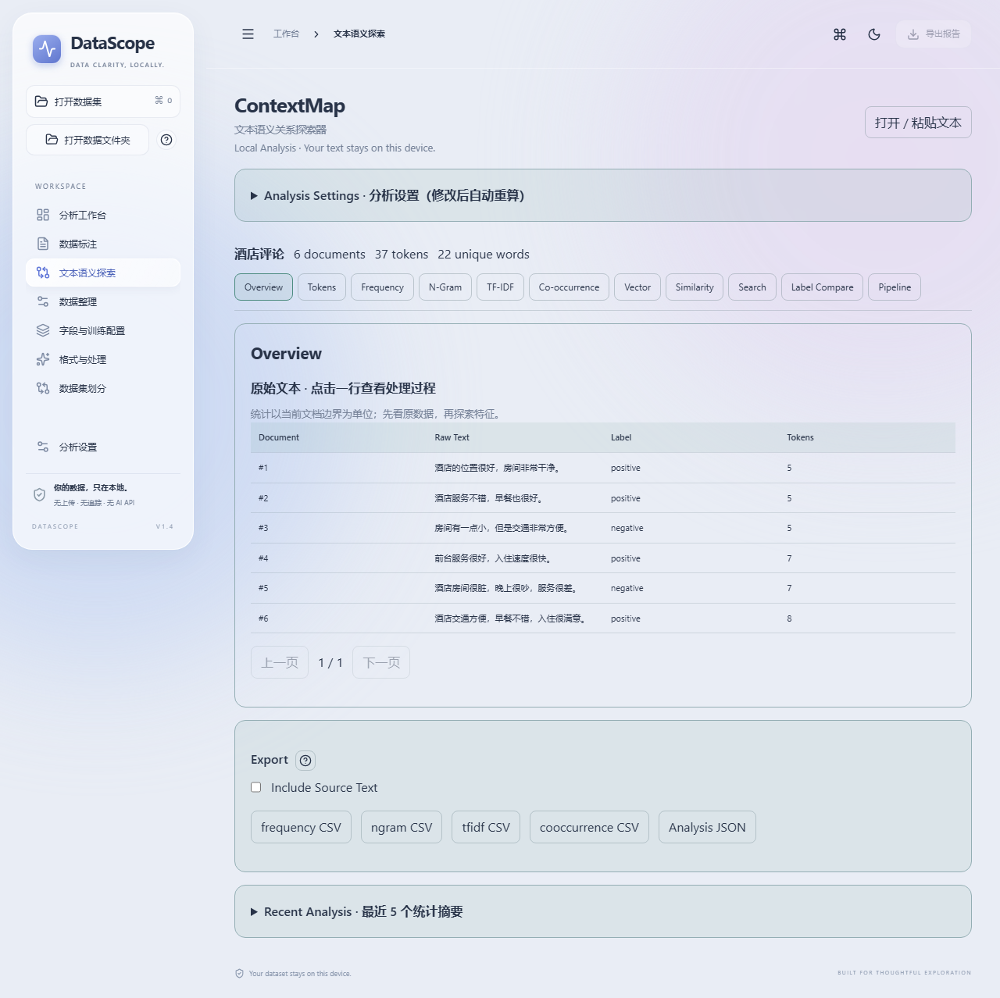
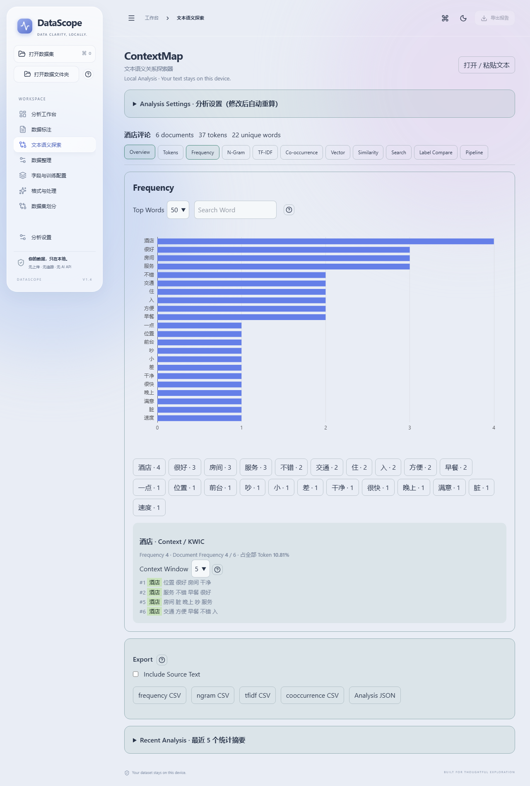
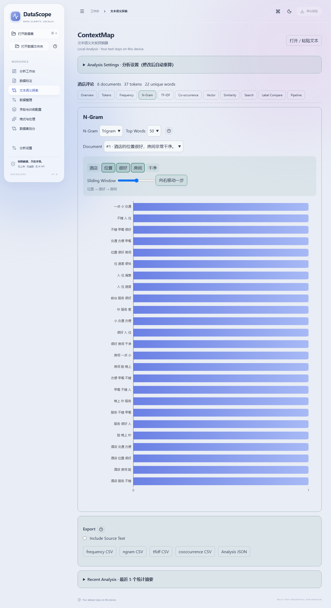
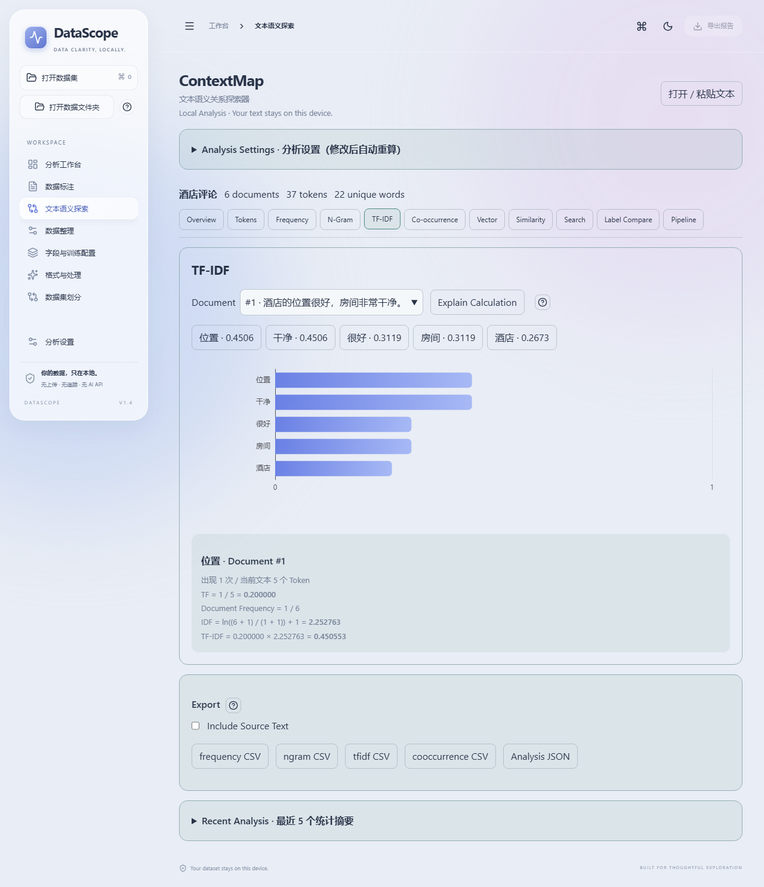
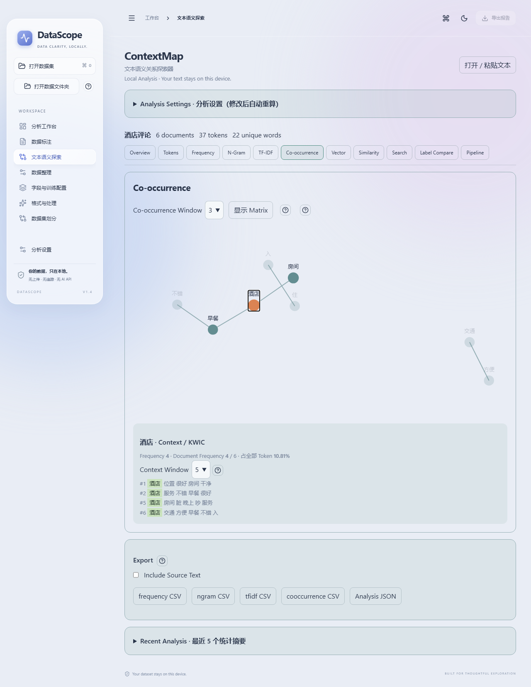
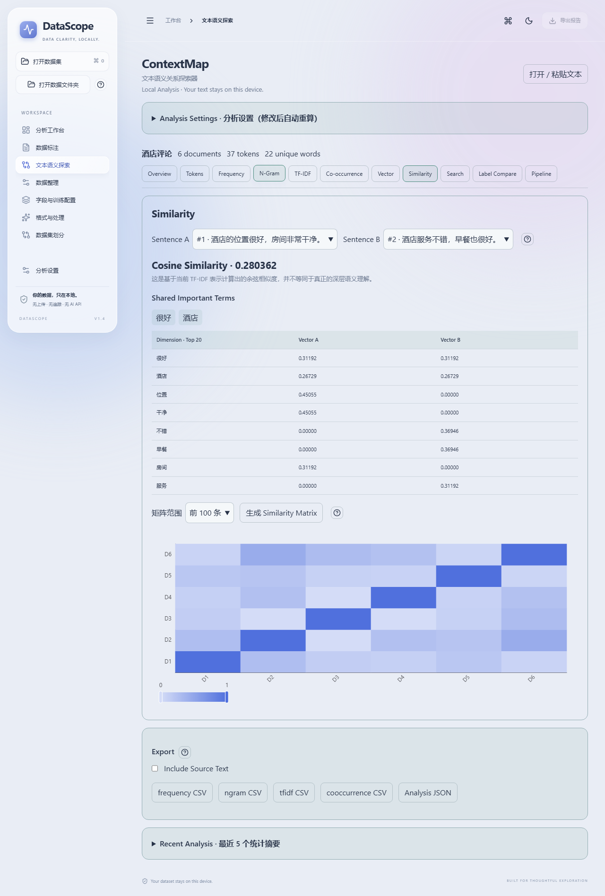
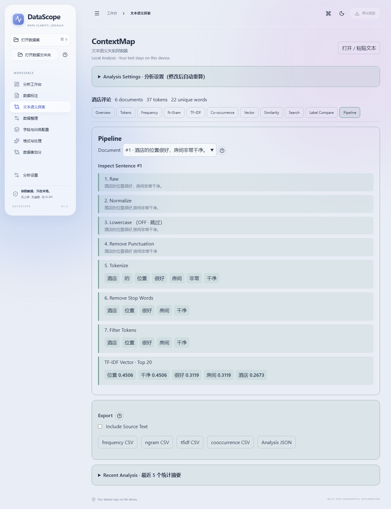
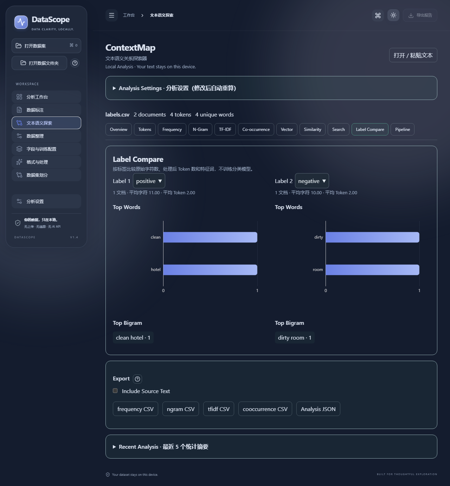
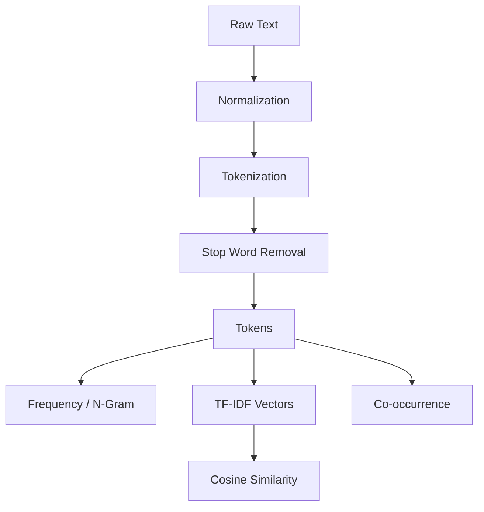

# ContextMap · 文本语义关系探索器

## Introduction

**Explore how text becomes features.** ContextMap 是 **DataScope 内置模块**，从左侧「文本语义探索」进入；使用同一个 React 应用、Windows EXE、主题与本地数据入口，不是第二个应用。

## Why ContextMap

词频、TF-IDF、N-Gram 和余弦相似度很容易只停留在公式。ContextMap 展示原句、每一步中间值、词语上下文和真实权重，帮助学习者解释“为什么两个文本的特征向量接近”。这不是深层语义模型，更不训练分类器。

## Features

- 原始文本优先；粘贴、TXT、CSV、TSV，正文列与可选标签列，或沿用 DataScope 当前导入的原始数据。
- 中文 / 英文浏览器分词，可逐步开关的 Pipeline 和句子 Inspector。
- 词频、文档频次、KWIC 上下文、Unigram / Bigram / Trigram 与可拖动的滑动窗口。
- 实时 TF-IDF 公式解释、稀疏向量、余弦相似度和最多 100 条文档的矩阵。
- 共现热力图、D3 可拖动 / 缩放 / 平移 / 点击的词语关系图。
- 词语搜索、标签组词频 / Bigram / 平均长度对比。
- 原位问号动画；统计 CSV / JSON 导出；IndexedDB 最近 5 次摘要。

## Screenshots

以下由 `tests/contextmap.e2e.ts` 在真实应用中加载演示数据后截图，不是设计稿。重新生成：`npm run build && npm run test:ui -- tests/contextmap.e2e.ts`。

| 原始文本 | 词频与上下文 |
|---|---|
|  |  |
|  |  |
|  |  |
|  |  |

## Demo

内置「酒店评论」「新闻文本」「技术文章」「短句相似度」，无需注册。技术文章示例可切换 English，自动启用小写规范化。

[Live Demo · DataScope](https://fqxxzyw.github.io/DataScope/) → 文本语义探索。
仓库需启用 GitHub Pages / GitHub Actions 部署源；部署状态以 Actions 中 `GitHub Pages` 工作流为准。

## How It Works / NLP Pipeline



原数据预览后明确文档边界和字段。Pipeline Inspector 为每条文档保留 Raw、Normalize、Lowercase、Remove Punctuation、Tokenize、Remove Stop Words、Filter Tokens 的真实结果。关闭某步会标记 OFF，不悄悄执行。
标点用空格替换，避免英文 `hello,world` 被合并成 `helloworld`。关闭标点清理后，分词器仍只提取词语；因此中间文本会改变，但最终词频可能相同。关闭词典分词时仅按空白拆分。

## Tokenization / Stop Words

中文使用 **Intl.Segmenter('zh', {granularity: 'word'})** 的本地 ICU 词典分词，不下载模型、不调用云服务。它是轻量浏览器方案，不等同于 jieba；版本间词边界可能不同，专有名词和新词不一定切分理想。英文提取 Unicode 字母 / 数字词与内部撇号。切换 English 时默认 Lowercase ON。

内置中英文基础停用词，可添加、逐个删除和恢复默认。精确 Token 匹配，不按子串删除。列表保存在 `contextmap-customStopWords`；“Show Stop Words”显示删除与长度过滤前的分词。

## Word Frequency / KWIC

Frequency 是某词全部出现次数，Document Frequency 是包含该词的文档数，同一文档重复出现只贡献一次 DF。百分比为该词次数 / 全部处理后 Token 数。
**KWIC**（Key Word In Context）围绕匹配 Token 展示前后 3 / 5 / 10 个 Token，帮助发现高频词所处的具体语境。最多显示 30 个匹配，不跨越文档边界。

## N-Gram

N-Gram 是连续 N 个 Token。`我 / 喜欢 / 学习 / NLP` 的 Bigram 是 `我 喜欢`、`喜欢 学习`、`学习 NLP`。窗口每次向右移动 1 个位置。每篇文档单独取窗口，绝不把上一条末尾和下一条开头连接。统计使用预处理后的 Token，所以删除停用词会改变相邻关系。

## TF / IDF / TF-IDF

纯函数位于 `src/contextmap/nlp.ts`：

- `TF(t,d) = count(t,d) / total_tokens(d)`：归一化文档长度。空文档 TF 为 0。
- `IDF(t) = ln((N + 1) / (df(t) + 1)) + 1`：采用平滑公式。普遍出现的词 IDF 较低，但不会降到零。
- `TF-IDF(t,d) = TF(t,d) × IDF(t)`：词在当前文档的相对重要性乘以它在整个语料中的区分度。

页面点击任何词，显示实际 count、total、N、DF、TF、IDF 和乘积；不是硬编码示例。窗口 / 词频显示阈值不改变 IDF 的语料集合。空 Token 文档仍计入总文档数 N。

## Co-occurrence

本项目明确采用**半径定义**：同一文档中两个不同词的 Token 位置距离 `1 ≤ j-i ≤ window`，共现次数加一。每个位置对只计算一次；重复位置对可增加次数，同词自环不计算。矩阵对称、对角线为零；这不是相关系数，也不是因果关系。
关系词表为满足频次阈值的前 100 词，但距离按完整 Token 序列计算，不会先删去词表外的词而缩短窗口。矩阵最多 30 词，网络默认 50、最多 100 节点；默认边权 ≥ 2。超过 500 条边要求调高阈值，不默默裁剪。

## Text Vectors / Cosine Similarity

统一词表中的每个词是一维，TF-IDF 是该维度的值。实现用稀疏对象保存非零值，不分配“文档数 × 全词表”的稠密数组。Vector 页面仅展示当前文档权重最高的 20 个维度。

`cos(A,B) = dot(A,B) / (norm(A) × norm(B))`

比较向量方向而非长度；TF-IDF 非负，结果在 0–1。空向量定义为 0，包含自己与自己比较。数值不等于“语义相同百分比”。相似度计算使用**完整向量**，表格展示统一选出的前 20 个维度。矩阵在 Worker 中计算，支持前 N 条、不重复随机 N 条和起始行之后 N 条；N ≤ 100。点击格子打开 A / B 对比。

## Architecture / Project Structure

```text
src/contextmap/
  ContextMap.tsx       DataScope 内置入口、Worker 生命周期
  InputPanel.tsx       文件预览、字段选择、粘贴、演示
  SettingsPanel.tsx    集中配置、停用词管理
  Views.tsx           各视图与句子 Inspector
  Network.tsx         D3 SVG 力导向图
  nlp.ts              纯函数：分词、频次、窗口、TF-IDF、余弦
  parser.ts           TXT / Papa Parse CSV、TSV
  analysis.worker.ts  解析、分析、矩阵的统一类型消息
  types.ts            文档、稀疏向量、结果、Worker 协议
  defaults.ts         限额与配置归一化
  store.ts            Zustand 与 localStorage 偏好
  history.ts          IndexedDB 聚合摘要
  export.ts           正确引用与转义的 CSV、JSON
  demos.ts            合成公开演示数据
```

React + TypeScript strict + Vite + Tailwind CSS（宿主）+ Zustand + ECharts + D3 + Lucide。无需 Node / Python 后端。
主线程负责交互和图表；文件解析、分词、TF-IDF、共现及相似度矩阵交给模块 Worker。设置变化延迟 250ms 重算并终止旧 Worker；过期结果不覆盖新结果。取消会终止当前 Worker。状态逐阶段显示真实任务，不虚构百分比。

## Supported Files

TXT 默认非空一行一文档，可选整篇。CSV 逗号、TSV Tab，支持引号、换行、UTF-8 BOM。表头开关保留无标题的第一行，自动列名有明确标记；列位置后缀区分重复列名。允许数值或文本标签。不支持 Excel；使用 DataScope 其他功能或外部工具转成 CSV。

## Getting Started / Testing / Build

Node.js 24：

```bash
npm install
npm run dev
npm run lint
npm run test
npm run build
npx playwright install chromium
npm run test:ui
```

Windows EXE：`npm run dist:win`；产物在 `release/`。`npm run test:desktop` 检查实际 EXE 的四种系统缩放、Worker 和导出。GitHub Actions 在 PR 执行同一检查，通过后才发布。

## Privacy / Storage / Export

没有账号、遥测、云 API 或追踪 SDK。文本只在当前浏览器 / EXE 的内存和 Worker 中。

IndexedDB `datascope-contextmap` v1 / `history` 表，以时间戳为主键；保留最近 5 个记录：文件名、时间、文档 / Token / 词表数量、设置、频次、N-Gram、共现聚合统计。**不保存原始文档、逐句 Token、Pipeline 或逐文档向量**。历史只能回看摘要，重做交互需再次导入。聚合统计本身仍可能含敏感词，请按需要清除历史。

localStorage 只保存设置、停用词和宿主主题等偏好，不存完整语料。默认导出词频、N-Gram、TF-IDF、共现 CSV 或 Analysis JSON。CSV 包含真实表头、双引号与换行转义。JSON 默认无 source；只有主动勾选 Include Source Text 才附带原文和标签。

## GitHub Pages

Vite 的 `base: './'` 同时支持 `/DataScope/` 和 Electron 文件协议。仓库 Settings → Pages → Source 选择 **GitHub Actions**，main 更新触发 `.github/workflows/deploy.yml`：安装、lint、test、build、upload-pages-artifact、deploy-pages。仓库已有 CI 检查和 Windows Release 流程，均保留。

## Limitations

最多 10,000 文档、200 万字符、50 万 Token、50,000 词表；空行不算文档。界面分页原文，图表限制 Top N。10,000 条短文档有回归测试，但长文档的内存与耗时取决于设备。中文 ICU 分词没有自定义词典；自动分词不能保证示例中每一个短语都恰好保持整体。N-Gram 使用处理后序列，统计关系不代表语义或因果。相似度不是深层理解，不包含训练、情感模型、BERT、LLM 或 Embedding API。

## Roadmap

可考虑词典扩展、离线 Word2Vec 向量导入、Embedding 表示比较和主题模型；当前版本未实现这些功能。

## Contributing / License

见 [CONTRIBUTING.md](../CONTRIBUTING.md)。[MIT License](../LICENSE)。保持小型、可解释、可测试和完全本地。
